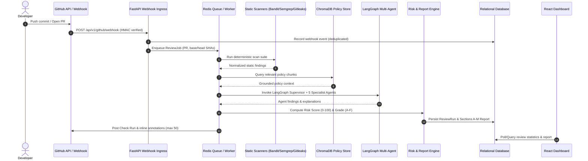

# System Architecture

**Analysis Date:** 2026-10-24

## Pattern Overview

**Overall:** Event-Driven Modular Monolith with Decoupled Background Workers, Multi-Agent StateGraph, and Modern Single Page Application (SPA).

**Key Characteristics:**
- **Asynchronous & Non-Blocking:** Entire backend built on Python asyncio, async database drivers (`aiosqlite`, `asyncpg`), and async HTTP clients (`httpx`).
- **Deterministic-First AI Pipeline:** Static analysis tools run first to establish ground truth facts before AI specialist agents synthesize context and generate fixes.
- **Fail-Safe & Idempotent:** Webhook deliveries, background jobs, and review runs are strictly deduplicated via SHA-256 event fingerprints.
- **Multi-Tenant Isolation:** Query-level isolation enforcing tenant and organization boundaries across all database repositories.

## Conceptual Layers

### 1. Presentation Layer (`apps/frontend/`)
- **Technology:** React 18, TypeScript, Vite, Tailwind CSS, Lucide Icons, Recharts.
- **Responsibilities:**
  - Real-time rendering of PR review statuses, findings, and interactive diff visualizers.
  - Cosmic Plasma Nebula Dark aesthetic with responsive glassmorphism cards and SVG score gauges.
  - Multilingual voice synthesis player for audible code remediation explanations.
  - Live policy knowledge base search and rule browsing.

### 2. API & Routing Layer (`apps/backend/app/api/v1/`)
- **Technology:** FastAPI 0.110+ routers, Pydantic schemas, dependency injection.
- **Endpoints:**
  - `/api/v1/auth`: Token issuance, user profile, role validation.
  - `/api/v1/repositories`: Repository onboarding, GitHub metadata validation, monitoring toggle.
  - `/api/v1/pull-requests`: Pull request listing, commit history, review run retrieval.
  - `/api/v1/reviews`: Trigger reviews, check review job progress, fetch Sections A-M report.
  - `/api/v1/findings`: Query, filter, and inspect findings with file paths, line numbers, and evidence.
  - `/api/v1/scanners`: Scanner tool status and health monitoring.
  - `/api/v1/agents`: Multi-agent state and specialist status inspection.
  - `/api/v1/integrations`: System connectivity check (Database, Redis, ChromaDB, GitHub, LLM).
  - `/api/v1/optimization`: AST algorithmic complexity optimization and PCM WAV audio stream.
  - `/api/v1/fix-prs`: Isolated branch remediation and draft PR generation.
  - `/api/v1/audit/logs`: Immutable audit trail for compliance and tracking.

### 3. Queue & Background Processing Layer (`apps/backend/app/workers/`)
- **Technology:** Redis Streams with fallback to in-memory `asyncio.Queue`.
- **Responsibilities:**
  - Decouples HTTP request ingestion from heavy scanner and agent workloads.
  - Exponential backoff retry mechanism with max 3 attempts.
  - Dead Letter Queue (DLQ) for failed jobs with administrative error alerts.

### 4. Scanner & Static Analysis Layer (`apps/backend/app/scanners/`)
- **Technology:** Bandit, Semgrep, Gitleaks, ESLint.
- **Responsibilities:**
  - Deterministic execution in sandboxed subprocesses (`shell=False`).
  - Schema normalization converting divergent tool outputs into unified `RawFinding` structures.
  - Strict error reporting (never masking scanner crashes as clean scores).

### 5. Multi-Agent Intelligence Layer (`apps/backend/app/agents/`)
- **Technology:** LangGraph StateGraph, LangChain Core.
- **Responsibilities:**
  - Supervisor agent dynamically routes review state to 5 specialist agents:
    1. **Security Specialist:** Checks OWASP Top 10, CWE patterns, injection vectors.
    2. **Quality Specialist:** Checks cyclomatic complexity, code smells, readability.
    3. **Testing Specialist:** Analyzes unit test adequacy, edge cases, regression risk.
    4. **Documentation Specialist:** Verifies docstrings, API specs, architectural alignment.
    5. **Dependency Specialist:** Scans lockfiles, licensing issues, CVE advisories.
  - Graph compiles state mutations into a unified immutable `ReviewState`.

### 6. Policy RAG Layer (`apps/backend/app/rag/`)
- **Technology:** ChromaDB, Sentence Transformers / LangChain Embeddings.
- **Responsibilities:**
  - Ingestion and chunking of internal engineering and security policies.
  - Semantic similarity search providing grounded reference citations to agents.

### 7. Risk & Report Generation Layer (`apps/backend/app/risk/` & `app/reports/`)
- **Responsibilities:**
  - Deterministic risk formula computing Score (0-100) and Letter Grade (A-F).
  - Production of comprehensive Sections A through M reports.

### 8. Remediation Sandbox Layer (`apps/backend/app/remediation/`)
- **Responsibilities:**
  - 5-stage validation sandbox:
    1. AST syntax parsing
    2. Static re-scan verification
    3. Unit test pass confirmation
    4. Regression guard
    5. Isolated git branch creation (`codeguardian/fix-...`) and draft PR creation.

### 9. Persistence & Storage Layer (`apps/backend/app/models/` & `app/database/`)
- **Technology:** SQLAlchemy 2.0 Async, aiosqlite / asyncpg.
- **Responsibilities:**
  - Relational mapping of 13 core models (`User`, `Repository`, `PullRequest`, `ReviewJob`, `ReviewRun`, `Finding`, `FindingEvidence`, `AgentRun`, `Policy`, `PolicyChunk`, `RemediationAttempt`, `FixPR`, `AuditLog`).

## Data Flow: Pull Request Review Lifecycle

---
*Architecture analysis: 2026-10-24*
