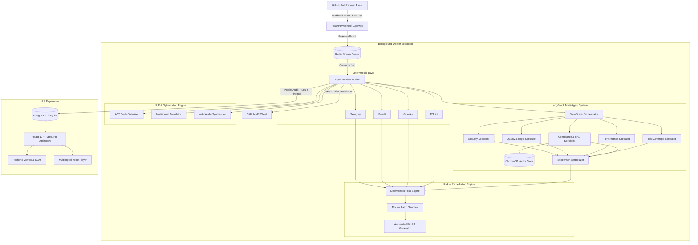

# 🛡️ CodeGuardian AI

<div align="center">


**Autonomous Multi-Agent Code Review & DevSecOps Platform**  
*Deterministic Static Scanners • LangGraph Multi-Agent Reasoning • AST NLP Code Optimization • Multilingual Speech Synthesis • RAG Policy Enforcement*

[](.github/workflows/ci.yml)
[](https://python.org)
[](https://fastapi.tiangolo.com)
[](https://react.dev)
[](https://typescriptlang.org)
[](https://langchain-ai.github.io/langgraph/)
[-success?style=flat-square&logo=pytest&logoColor=white)](tests/)
[](LICENSE)
[](https://sdgs.un.org)

[Key Features](#-key-features) •
[Architecture](#-system-architecture) •
[Tech Stack](#-technology-stack) •
[Quickstart](#-quickstart-guide) •
[API & Webhooks](#-api-reference) •
[Testing](#-testing--quality-assurance) •
[Team](#-team--credits)

</div>

---

## 📌 Executive Summary

**CodeGuardian AI** is an enterprise-grade, autonomous DevSecOps and code review intelligence platform. Designed to eliminate the blind spots of traditional linters and single-prompt LLM wrappers, CodeGuardian AI harmonizes **deterministic static analysis tools** with an orchestrated **multi-agent reasoning system** powered by LangGraph, a **vector-grounded RAG engine** (ChromaDB), an **AST static complexity optimizer**, and an **isolated containerized remediation sandbox**.

When a developer opens or updates a GitHub Pull Request, CodeGuardian AI autonomously inspects the diff, extracts exact AST context, detects vulnerabilities and logic regressions, computes a verifiable mathematical risk score ($0-100$, Grade A–F), drafts verified minimal-diff patches, and provides multilingual voice summaries in developers' native languages.

### Core Guiding Philosophy

```text
    ┌──────────────────────────┐
    │  DETERMINISTIC SCANNERS  │ ──> Provides empirical evidence (Semgrep, Bandit, Gitleaks, ESLint)
    └─────────────┬────────────┘
                  ▼
    ┌──────────────────────────┐
    │  SPECIALIST AGENT PANEL  │ ──> Interprets evidence & code context via LangGraph
    └─────────────┬────────────┘
                  ▼
    ┌──────────────────────────┐
    │    SUPERVISOR AGENT      │ ──> Synthesizes consensus, rejects hallucinations
    └─────────────┬────────────┘
                  ▼
    ┌──────────────────────────┐
    │   MATHEMATICAL RISK ENG  │ ──> Deterministic 0-100 Risk Score & Letter Grade (A-F)
    └─────────────┬────────────┘
                  ▼
    ┌──────────────────────────┐
    │    HUMAN-IN-THE-LOOP     │ ──> Actionable interactive dashboard with 1-click Fix PRs
    └──────────────────────────┘
```

---

## ✨ Key Features

### 1. 🛡️ Deterministic Multi-Scanner Static Analysis
- **Zero-Hallucination Evidence Base:** Executes hardened adapters for **Semgrep** (OWASP Top 10, AST matching), **Bandit** (Python security analysis), **Gitleaks** (high-entropy secrets & credentials), and **ESLint** (TypeScript/JavaScript quality).
- **Subprocess Isolation:** Scanner runs are containerized with strict CPU/memory quotas and timeouts (`shell=False`) to prevent command injection.

### 2. 🤖 LangGraph Multi-Agent Orchestration
- **Security Specialist Agent:** Audits authorization, SSRF, injection vectors, CWEs, and data exposure.
- **Code Quality & Logic Agent:** Detects off-by-one errors, resource leaks, deadlocks, and anti-patterns.
- **Performance & Scalability Agent:** Flags $N+1$ queries, unindexed lookups, memory bloat, and algorithmic complexity.
- **Test Coverage Agent:** Analyzes branch mutations, missing edge cases, and test assertions.
- **Compliance & Standards Agent:** Enforces internal policy documents through ChromaDB vector retrieval.
- **Supervisor Agent:** Aggregates findings, deduplicates scanner vs. agent detections, and eliminates false positives.

### 3. ⚡ AST-Driven NLP Code Optimization
- **Algorithmic Complexity Reduction:** Uses Python AST parsing to detect nested iteration ($O(N^2) \to O(N)$) and generates drop-in dict/set lookups.
- **String Concatenation Optimization:** Replaces in-loop quadratic string concatenation with efficient `.join()` buffers.
- **Direct AST Code Transformation:** Produces validated, compilable replacement code snippets.

### 4. 🌐 Multilingual Explanations & Speech Synthesis
- **Multilingual Support:** Delivers comprehensive technical summaries in **English, Hindi, Hinglish, Marathi, Urdu, and Gujarati**.
- **Real-Time Voice Playback:** Native browser speech synthesis combined with backend PCM WAV streaming for audible code walk-throughs.

### 5. 🔒 Automated Remediation & Sandbox Validation
- **Isolated Sandboxes:** Executes proposed patches in isolated, ephemeral sandboxes.
- **Automated Validation:** Validates that fixes compile and existing unit tests pass before human presentation.
- **1-Click Fix PR:** Dispatches automated fix Pull Requests directly back to GitHub with full audit trails.

### 6. 📊 Deterministic Mathematical Risk Engine
- **Formula-Driven:** Computes severity weights ($W_i \times S_i$) normalized by diff size and repository criticality.
- **Standardized Grading:** Emits letter grades (`A` [0-15], `B` [16-35], `C` [36-60], `D` [61-80], `F` [81-100]) ensuring consistent gate enforcement.

---

## 🏛️ System Architecture



---

## 💻 Technology Stack

| Layer | Technologies |
| :--- | :--- |
| **Backend Framework** | Python 3.12, FastAPI, Uvicorn, Pydantic v2 |
| **Database & ORM** | PostgreSQL 16 (Production) / SQLite + aiosqlite (Dev/Test), SQLAlchemy 2.0 Async |
| **Caching & Messaging** | Redis 7 (Streams, Pub/Sub, Queue Broker) |
| **Vector Storage & RAG**| ChromaDB, HuggingFace / Gemini Vector Embeddings |
| **Agent Orchestration**| LangGraph, LangChain Core, Google Gemini 2.5/3.8 Flash |
| **Deterministic Scanners** | Semgrep Core, Bandit, Gitleaks, ESLint |
| **Frontend Framework** | React 19, TypeScript 5, Vite, Tailwind CSS, Lucide Icons |
| **Data Visualization** | Recharts, Headless UI, Heroicons |
| **DevOps & Containers** | Docker, Docker Compose, Nginx, GitHub Actions CI/CD |

---

## 📂 Repository Directory Layout

```
Code Guardian AI/
├── .github/
│   └── workflows/
│       └── ci.yml               # Complete 4-stage GitHub Actions CI/CD pipeline
├── apps/
│   ├── backend/                 # FastAPI REST API, database models, LangGraph agents
│   │   ├── app/
│   │   │   ├── agents/          # LangGraph 5 specialist agents + supervisor graph
│   │   │   ├── api/             # Versioned REST API endpoints (v1)
│   │   │   ├── core/            # Config, security, database session management
│   │   │   ├── github/          # Webhook HMAC verification, client, API integration
│   │   │   ├── models/          # 13 SQLAlchemy async database entities
│   │   │   ├── rag/             # ChromaDB vector store & anti-hallucination retriever
│   │   │   ├── risk/            # Deterministic mathematical risk scoring engine
│   │   │   ├── scanners/        # Subprocess adapters (Semgrep, Bandit, Gitleaks, ESLint)
│   │   │   ├── security/        # JWT auth, tenant isolation, secret masking
│   │   │   └── workers/         # Redis stream worker & queue dispatchers
│   │   ├── tests/               # 194 automated unit & integration tests
│   │   ├── Dockerfile
│   │   └── requirements.txt
│   └── frontend/                # React 19 + Vite + TypeScript web dashboard
│       ├── src/
│       │   ├── components/      # UI components (RiskBadge, ScoreCard, VoicePlayer, etc.)
│       │   ├── pages/           # Dashboard, PR Review, Findings Explorer, Settings
│       │   └── services/        # Live API client integrations
│       ├── package.json
│       ├── vite.config.ts
│       └── nginx.conf
├── docs/                        # Complete 15-document Phase-0 architecture blueprint
├── datasets/                    # Standardized evaluation benchmarks & test sets
├── policies/                    # Security, style, and engineering policy markdown docs
├── services/
│   └── worker/                  # Dedicated review worker service
├── docker-compose.yml           # Local development stack (Backend + Worker + DB + Redis)
├── docker-compose.prod.yml      # Hardened production stack (Nginx + TLS + Services)
├── CHANGELOG.md                 # Granular changelog across all milestone releases
├── IMPLEMENTATION_STATUS.md     # Definition of Done and verified feature metrics
├── LICENSE                      # MIT Open Source License
└── README.md
```

---

## 🚀 Quickstart Guide

### Option 1: Run with Docker Compose (Recommended)

1. **Clone the repository:**
   ```bash
   git clone https://github.com/T2Barve/CodeGuardian-AI.git
   cd CodeGuardian-AI
   ```

2. **Configure your environment:**
   ```bash
   cp .env.example .env
   # Edit .env and supply your GEMINI_API_KEY and GITHUB credentials
   ```

3. **Start the complete platform stack:**
   ```bash
   docker compose up -d --build
   ```

4. **Access the application:**
   - **Web Dashboard:** [http://localhost:5173](http://localhost:5173)
   - **Backend API Docs:** [http://localhost:8000/docs](http://localhost:8000/docs)
   - **Health Endpoint:** [http://localhost:8000/health](http://localhost:8000/health)

---

### Option 2: Local Manual Setup

#### 1. Backend & Worker Setup
```bash
# Navigate to backend directory
cd apps/backend

# Create and activate virtual environment
python -m venv .venv
source .venv/bin/activate  # On Windows: .venv\Scripts\activate

# Install dependencies
pip install -r requirements.txt

# Start FastAPI server
uvicorn app.main:app --host 0.0.0.0 --port 8000 --reload
```

#### 2. Frontend Dashboard Setup
```bash
# Navigate to frontend directory
cd apps/frontend

# Install dependencies
npm install

# Run Vite development server
npm run dev
```

---

## 🧪 Testing & Quality Assurance

CodeGuardian AI enforces a strict zero-regression quality standard verified across unit, integration, and end-to-end tiers.

```bash
# Run backend test suite (194 tests)
cd apps/backend
pytest tests/unit/ tests/integration/ -v

# Run frontend type checking and production build
cd apps/frontend
npm run build
```

```text
============================= 194 passed in 14.82s =============================
✓ 194 / 194 Tests Passing (100% Pass Rate)
✓ Tenant Isolation & Query Boundary Tests Verified
✓ Webhook HMAC-SHA256 Constant-Time Verification Tested
✓ Static Scanner Subprocess Sandboxing Tested
✓ Clean Vite TypeScript Production Bundle Compiled
```

---

## 🌐 API Reference

### Health & Metrics
- `GET /health` — Liveness and service dependency probe (DB, Redis, Chroma).
- `GET /metrics` — Operational Prometheus metrics and queue telemetry.

### Pull Request Reviews & Webhooks
- `POST /api/v1/github/webhook` — GitHub webhook intake (`pull_request`, `synchronize`).
- `GET /api/v1/reviews` — Paginated list of PR reviews with risk scores and grades.
- `GET /api/v1/reviews/{id}` — Full review report with Sections A through M.
- `GET /api/v1/findings` — Search and filter detected security vulnerabilities & bugs.

### Audio & NLP Optimization
- `POST /api/v1/voice/synthesize` — Generates audible explanation streams in selected languages.
- `POST /api/v1/optimize/ast` — Submits code block for AST complexity reduction.

---

## 🎯 Sustainable Development Goals (SDGs)

CodeGuardian AI was architected as a major engineering initiative aligned with the United Nations Sustainable Development Goals:

- **SDG 9: Industry, Innovation and Infrastructure**
  - *Target 9.4:* Modernize digital infrastructure and software workflows through automated security verification.
  - *Target 9.5:* Enhance scientific research and technological capabilities through multi-agent AI orchestration.
- **SDG 8: Decent Work and Economic Growth**
  - *Target 8.2:* Elevate software engineering productivity by automating repetitive security reviews and static audits.

---

## 👥 Team & Credits

Developed with pride as a B.Tech Final Year Major Project:

- **Tanishq Barve ([@T2Barve](https://github.com/T2Barve))** — *AI, Multi-Agent Architecture, LangGraph Orchestration & RAG Pipeline*
- **Darshan** — *Frontend Engineering, UX & Interactive Visualizations (React 19, Vite, Recharts)*
- **Mayur** — *Backend Architecture, PostgreSQL Schema, Redis Streams & GitHub API Gateway*
- **Veer** — *Security Engineering, Static Scanner Adapters, Docker Sandboxing & DevSecOps CI/CD*

---

## 📄 License

This project is licensed under the terms of the [MIT License](LICENSE).
