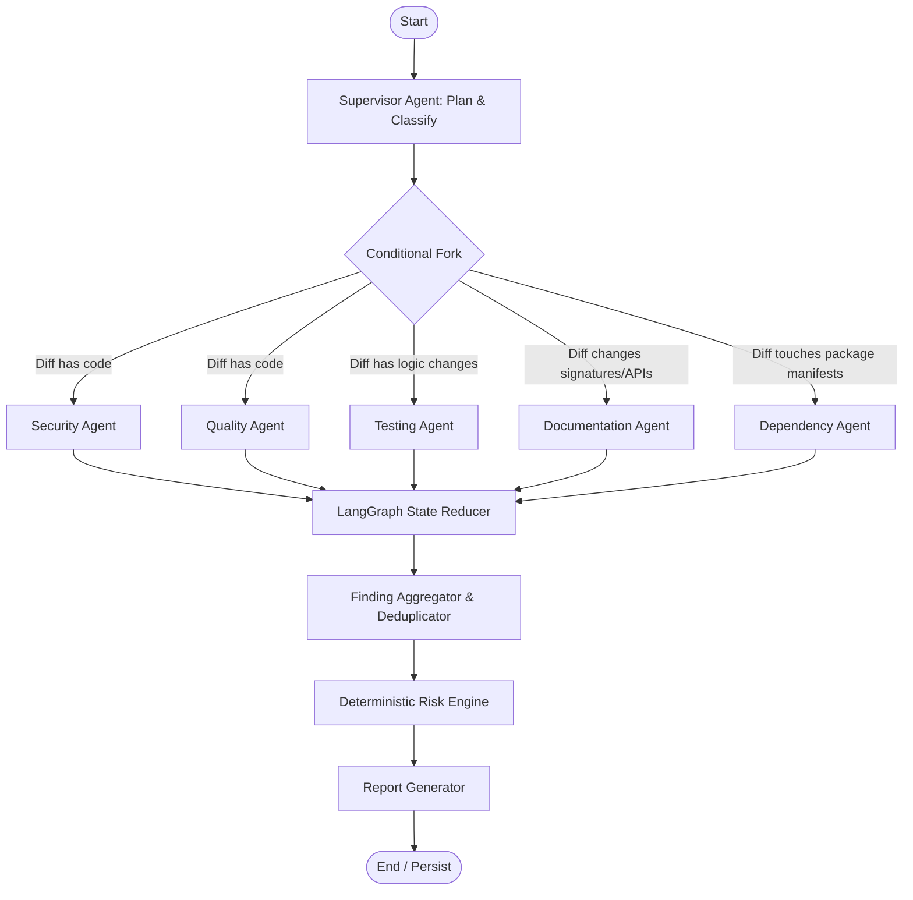

# CodeGuardian AI — Multi-Agent System Design (LangGraph)

**Document:** Agent Architecture, Prompts, Schemas & Security Boundaries  
**Framework:** LangGraph (StateGraph)  
**Status:** Approved Architectural Baseline  
**Version:** 1.0.0 (Phase 0)  

---

## 1. Multi-Agent Philosophy & Coordination Model

The fundamental multi-agent principle of CodeGuardian AI is:
> **Specialist agents do not hallucinate evidence. They receive verified scanner outputs, AST code structures, and retrieved policies, then perform expert contextual reasoning.**

LangGraph coordinates this execution through a central typed state: `ReviewState`.



---

## 2. Shared State (`ReviewState`)

```python
from typing import List, Dict, Any, Optional
from pydantic import BaseModel, Field

class ReviewState(BaseModel):
    # PR Context
    repo_owner: str
    repo_name: str
    pr_number: int
    commit_sha: str
    changed_files: List[str]
    diff_content: str
    
    # Tool Evidence
    normalized_scan_results: List[Dict[str, Any]] = Field(default_factory=list)
    retrieved_policies: List[Dict[str, Any]] = Field(default_factory=list)
    ast_metadata: Dict[str, Any] = Field(default_factory=dict)
    
    # Agent Outputs
    security_findings: List[Dict[str, Any]] = Field(default_factory=list)
    quality_findings: List[Dict[str, Any]] = Field(default_factory=list)
    testing_findings: List[Dict[str, Any]] = Field(default_factory=list)
    documentation_findings: List[Dict[str, Any]] = Field(default_factory=list)
    dependency_findings: List[Dict[str, Any]] = Field(default_factory=list)
    
    # Pipeline Status & Telemetry
    agent_errors: Dict[str, str] = Field(default_factory=dict)
    token_usage: Dict[str, int] = Field(default_factory=dict)
    
    # Final Synthesized Outputs
    correlated_findings: List[Dict[str, Any]] = Field(default_factory=list)
    risk_score: float = 0.0
    risk_grade: str = "A"
    summary_report: str = ""
```

---

## 3. Specialist Agent Specifications

---

### 3.1. Supervisor Agent

- **Purpose:** Orchestrates the multi-agent graph, analyzes PR metadata and file changes, dispatches tasks to specialist agents in parallel, and gathers outputs.
- **Inputs:** PR diff, changed file paths, raw scanner results, repository metadata.
- **Context:** List of active scanners, enabled policies, repository language profile.
- **Tools:** `classify_changed_files()`, `route_specialist_agents()`, `verify_agent_heartbeats()`.
- **Prompt Strategy:**
  - Instructed to act as Lead Architect.
  - Strict classification of files: backend code, frontend code, config files, test files, dependencies, docs.
  - Zero generation of security or quality findings directly; delegates to specialists.
- **Output Schema:**
  ```python
  class SupervisorRoutingDecision(BaseModel):
      active_agents: List[str] # ["security", "quality", "testing", "documentation", "dependency"]
      file_partitioning: Dict[str, List[str]] # agent_name -> file_paths
      rationale: str
  ```
- **Failure Modes:** Fallback to running all standard agents sequentially if dynamic routing classification fails.
- **Security Boundaries:** Operates strictly on parsed metadata; untrusted PR descriptions or diffs are fenced with triple-quote delimiters.

---

### 3.2. Security Agent

- **Purpose:** Evaluates CWE, OWASP Top 10, authentication/authorization logic, cryptographic implementations, and correlates deterministic scanner outputs (Semgrep, Bandit, Gitleaks).
- **Inputs:** Code diffs, scanner findings (`NormalizedScanResult`), security baseline policies.
- **Context:** Retrieved security standards from ChromaDB (e.g. database query sanitization, secret handling).
- **Tools:** `get_scanner_evidence()`, `query_security_rag_policies()`.
- **Prompt Strategy:**
  - System role: Senior Application Security Engineer.
  - Required to cite tool evidence (rule ID, scanner message) or pinpoint exact source lines for logic flaws.
  - Strict instruction to discount false positives if surrounding code provides proof of sanitization.
- **Output Schema:**
  ```python
  class SecurityFindingItem(BaseModel):
      fingerprint_components: List[str]
      cwe_id: Optional[str]
      severity: str # CRITICAL, HIGH, MEDIUM, LOW, INFO
      confidence: float # 0.0 to 1.0
      file_path: str
      line_start: int
      line_end: int
      title: str
      description: str
      exploitability_analysis: str
      recommendation: str
      evidence_source: str # e.g. "bandit:B608 + manual_context"
      policy_reference: Optional[str]
  ```
- **Failure Modes:** If scanner evidence is missing, analyzes purely for logic flaws with reduced confidence score (capped at 0.70 max).
- **Security Boundaries:** Never echoes back detected secrets into the final report; secrets are redacted with `[REDACTED_SECRET]`.

---

### 3.3. Quality Agent

- **Purpose:** Evaluates code maintainability, cognitive and cyclomatic complexity, code duplication, architectural coupling, and adherence to language-specific coding standards.
- **Inputs:** Changed files, AST metrics (function length, branching factor), coding standard policies.
- **Context:** Language-specific style and architecture guidelines retrieved via RAG.
- **Tools:** `compute_ast_metrics()`, `query_quality_rag_policies()`.
- **Prompt Strategy:**
  - System role: Senior Software Craftsmanship & Architecture Specialist.
  - Ground all critiques in retrieved policy or concrete metric threshold (e.g., "Function exceeds 50 lines").
- **Output Schema:**
  ```python
  class QualityFindingItem(BaseModel):
      fingerprint_components: List[str]
      severity: str
      confidence: float
      file_path: str
      line_start: int
      line_end: int
      title: str
      code_smell_type: str # COMPLEXITY, DUPLICATION, NAMING, COUPLING
      description: str
      recommendation: str
      policy_reference: Optional[str]
  ```
- **Failure Modes:** Gracefully skips files that cannot be parsed by AST without terminating the run.
- **Security Boundaries:** No execution of untrusted code; static inspection only.

---

### 3.4. Testing Agent

- **Purpose:** Evaluates test coverage gaps, maps modified AST functions to existing test suites, and flags untested branches or critical edge cases.
- **Inputs:** PR diff, list of test files, AST function mappings.
- **Context:** Project testing policies (e.g. "All endpoints require integration tests").
- **Tools:** `map_modified_functions_to_tests()`, `query_testing_rag_policies()`.
- **Prompt Strategy:**
  - System role: Senior QA & Test Automation Specialist.
  - Highlights regression vulnerabilities when complex business logic is modified without accompanying test updates.
  - May generate starter unit test skeletons clearly marked as `AI_GENERATED_STARTER_TEST`.
- **Output Schema:**
  ```python
  class TestingGapItem(BaseModel):
      file_path: str
      untested_symbol: str
      risk_level: str # HIGH, MEDIUM, LOW
      missing_test_type: str # UNIT, INTEGRATION, EDGE_CASE
      rationale: str
      suggested_test_skeleton: Optional[str]
  ```
- **Failure Modes:** If test mapping fails, reports generic test gap warning if no test files are present in the PR diff.
- **Security Boundaries:** Generated test skeletons must not include external network requests or shell executions.

---

### 3.5. Documentation Agent

- **Purpose:** Identifies missing public API docstrings, invalid parameter docs, mismatched README updates, and outdated comments.
- **Inputs:** Diffs of exported interfaces, functions, classes, and Markdown documentation.
- **Context:** Documentation standard policies.
- **Tools:** `query_doc_policies()`.
- **Prompt Strategy:**
  - Evaluates only public or critical internal interfaces; ignores private/internal helpers to avoid notification fatigue.
- **Output Schema:**
  ```python
  class DocumentationFindingItem(BaseModel):
      file_path: str
      line_start: int
      line_end: int
      title: str
      description: str
      recommendation: str
  ```
- **Failure Modes:** Non-critical agent; timeouts or errors do not impact review status.

---

### 3.6. Dependency Agent

- **Purpose:** Inspects package manifest modifications (`requirements.txt`, `package.json`, `pyproject.toml`), detects unpinned or suspicious packages, and alerts on newly added direct dependencies.
- **Inputs:** Manifest diffs, lockfile changes.
- **Context:** Project dependency guidelines.
- **Tools:** `parse_manifest_diff()`.
- **Prompt Strategy:**
  - Focuses on version pinning, typosquatting indicators (uncommon package names), and license compatibility.
  - Never claims a package has a specific CVE without verified advisory database evidence.
- **Output Schema:**
  ```python
  class DependencyFindingItem(BaseModel):
      package_name: str
      version_specifier: str
      manifest_file: str
      severity: str
      risk_type: str # UNPINNED_VERSION, SUSPICIOUS_PACKAGE, UNNECESSARY_DEPENDENCY
      description: str
      recommendation: str
  ```
- **Failure Modes:** Bypassed if no package manifest files were modified in the PR.
