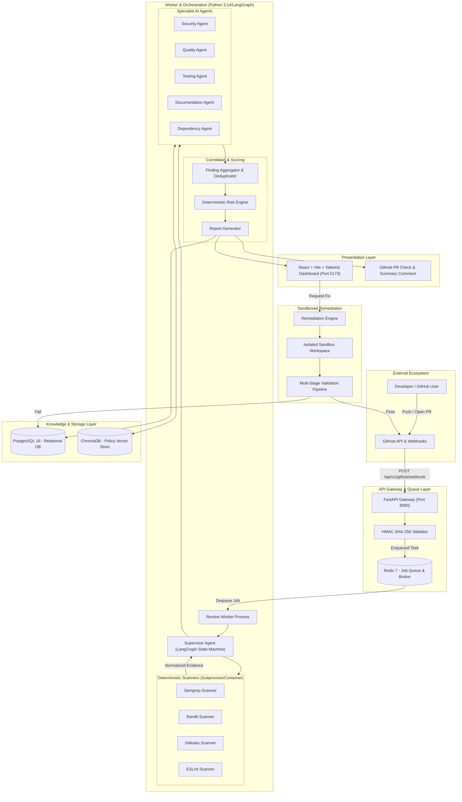

# CodeGuardian AI — Architecture Specification

**Document:** System Architecture & Technical Topology  
**Status:** Approved Architectural Baseline  
**Version:** 1.0.0 (Phase 0)  

---

## 1. Architectural Philosophy

CodeGuardian AI is built on the foundational rule:
```text
TOOLS PROVIDE EVIDENCE
        ↓
AGENTS INTERPRET EVIDENCE
        ↓
SUPERVISOR ORCHESTRATES
        ↓
AGGREGATOR CORRELATES
        ↓
RISK ENGINE PRIORITIZES
        ↓
HUMAN REVIEWS
```

The system rejects pure LLM guessing and insists on a **deterministic verification loop**: AI agents can only synthesize and contextualize findings backed by concrete scanner outputs, code AST metrics, test runner outputs, and retrieved engineering policies.

---

## 2. High-Level Architecture Diagram



---

## 3. Core Subsystems and Components

### 3.1. API Gateway Layer (FastAPI)
- **Role:** Exposes versioned REST endpoints (`/api/v1/*`), handles GitHub webhook ingestion, validates payload signatures, enforces authentication, and streams review telemetry.
- **Key Modules:**
  - `app/api/v1/endpoints/github.py`: Webhook verification and ingestion.
  - `app/api/v1/endpoints/reviews.py`: Review status query and finding retrieval.
  - `app/api/v1/endpoints/remediation.py`: Triggering and querying auto-fix workflows.
  - `app/api/v1/endpoints/policies.py`: Ingesting and querying RAG policies.

### 3.2. Asynchronous Queue & Worker (Redis + Python Worker)
- **Role:** Decouples long-running analysis workflows from synchronous HTTP requests.
- **Features:** Priority queues, exponential backoff retries, dead-letter queue (DLQ) for poisoned jobs, and atomic job state transitions recorded in PostgreSQL.

### 3.3. Deterministic Scanner Subsystem
- **Role:** Executes static analysis tools against cloned repository snapshots or changed file sets.
- **Isolation:** Runs scanners in temporary directories with read-only file mounts and execution time limits.
- **Normalization:** Maps heterogeneous scanner outputs into a unified `NormalizedScanResult` schema.

### 3.4. Multi-Agent Orchestrator (LangGraph)
- **State Machine:** Coordinates specialized agents via a unified `ReviewState` object.
- **Parallel Dispatch:** Executes independent agents (e.g., Security, Quality, Testing) concurrently using asynchronous tasks.
- **Fallback Resilience:** Individual agent exceptions are caught, logged, and isolated without halting overall review completion.

### 3.5. Knowledge & Policy Engine (ChromaDB RAG)
- **Role:** Stores company coding standards, security baselines, and architecture guidelines.
- **Semantic Retrieval:** Queries vector chunks using cosine similarity filtered by document tags and file extensions, supplying concrete policy citations to agents.

### 3.6. Finding Aggregator & Deterministic Risk Engine
- **Fingerprinting:** SHA-256 hash across `(repo_id, file_path, line_start, category, rule_id)`.
- **Deduplication:** Groups duplicate findings while chaining raw tool outputs into `FindingEvidence`.
- **Risk Calculation:** Computes reproducible composite risk scores ($0.0 - 100.0$) via mathematical weighting.

### 3.7. Sandboxed Remediation Engine
- **Role:** Generates targeted unified diff patches for confirmed findings.
- **Execution Sandbox:** Uses temporary directories to test patch application, run syntax linter, execute tests, and re-scan the patched code.

### 3.8. Frontend Presentation Dashboard (React + TypeScript + Vite)
- **Role:** Displays comprehensive review audits, risk trends, interactive code diffs, agent activity timelines, and one-click remediation controls.

---

## 4. Trust Boundaries & Security Zones

```text
[ UNTRUSTED ZONE ]
 - Pull Request Code, Branch Names, Diff Content
 - Commit Messages, Author Names, PR Descriptions
 - Inbound Webhook Payloads (until HMAC verified)
 - AI-generated Code Patches (until sandboxed validation passes)

               ↕ Boundary: HMAC Validation & Sanitization

[ DMZ / GATEWAY ZONE ]
 - FastAPI Endpoints with Pydantic Schema Validation
 - Redis Message Broker (internal Docker network)

               ↕ Boundary: Strict Process Isolation & Non-Root Execution

[ SECURE WORKER ZONE ]
 - Static Analysis Execution (Restricted subprocess, strict timeout)
 - LLM Abstraction Layer (Sanitized prompts with injection defense)
 - LangGraph Multi-Agent Engine
 - Relational Database (PostgreSQL) & Vector Store (ChromaDB)
```

---

## 5. Scaling Strategy

1. **Horizontal Worker Scaling:** The review worker pool can scale horizontally by launching additional worker containers consuming from the Redis queue.
2. **Stateless API Gateway:** The FastAPI web instances are completely stateless, allowing multi-instance deployment behind a reverse proxy (e.g., Nginx, Traefik).
3. **Database Read Replicas:** Read-heavy dashboard queries can be directed to PostgreSQL read replicas if review history expands.
4. **Vector DB Scaling:** ChromaDB runs embedded in development and can transition to a standalone ChromaDB/Qdrant service in high-load production environments.
