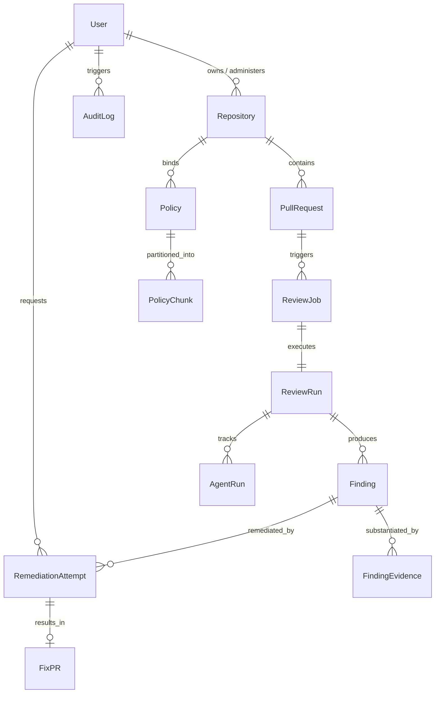

# CodeGuardian AI — Database Design Specification

**Document:** Relational Database Architecture & Entity Specifications  
**Engine:** PostgreSQL 16+  
**ORM & Migrations:** SQLAlchemy 2.0 (Async) + Alembic  
**Version:** 1.0.0 (Phase 0)  

---

## 1. Entity-Relationship Diagram (Mermaid)



---

## 2. Table Schemas and Constraints

### 2.1. `users`
Represents GitHub users and system administrators.
```sql
CREATE TABLE users (
    id UUID PRIMARY KEY DEFAULT gen_random_uuid(),
    github_id BIGINT UNIQUE NOT NULL,
    username VARCHAR(100) NOT NULL,
    email VARCHAR(255),
    avatar_url VARCHAR(512),
    role VARCHAR(32) NOT NULL DEFAULT 'DEVELOPER', -- ADMIN, DEVELOPER, REVIEWER
    created_at TIMESTAMPTZ NOT NULL DEFAULT NOW(),
    updated_at TIMESTAMPTZ NOT NULL DEFAULT NOW()
);
CREATE INDEX idx_users_github_id ON users(github_id);
```

### 2.2. `repositories`
Registered GitHub repositories under review protection.
```sql
CREATE TABLE repositories (
    id UUID PRIMARY KEY DEFAULT gen_random_uuid(),
    github_repo_id BIGINT UNIQUE NOT NULL,
    name VARCHAR(255) NOT NULL,
    owner VARCHAR(255) NOT NULL,
    url VARCHAR(512) NOT NULL,
    default_branch VARCHAR(100) NOT NULL DEFAULT 'main',
    language VARCHAR(64),
    is_active BOOLEAN NOT NULL DEFAULT TRUE,
    created_at TIMESTAMPTZ NOT NULL DEFAULT NOW(),
    updated_at TIMESTAMPTZ NOT NULL DEFAULT NOW()
);
CREATE INDEX idx_repositories_owner_name ON repositories(owner, name);
```

### 2.3. `pull_requests`
Pull requests ingested via webhooks.
```sql
CREATE TABLE pull_requests (
    id UUID PRIMARY KEY DEFAULT gen_random_uuid(),
    github_pr_id BIGINT UNIQUE NOT NULL,
    repository_id UUID NOT NULL REFERENCES repositories(id) ON DELETE CASCADE,
    number INTEGER NOT NULL,
    title VARCHAR(512) NOT NULL,
    author VARCHAR(255) NOT NULL,
    source_branch VARCHAR(255) NOT NULL,
    target_branch VARCHAR(255) NOT NULL,
    commit_sha VARCHAR(64) NOT NULL,
    status VARCHAR(32) NOT NULL DEFAULT 'OPEN', -- OPEN, CLOSED, MERGED
    created_at TIMESTAMPTZ NOT NULL DEFAULT NOW(),
    updated_at TIMESTAMPTZ NOT NULL DEFAULT NOW(),
    CONSTRAINT uq_repo_pr_number UNIQUE (repository_id, number)
);
CREATE INDEX idx_pull_requests_repo_number ON pull_requests(repository_id, number);
```

### 2.4. `review_jobs`
Asynchronous job tracking records for queue operations.
```sql
CREATE TABLE review_jobs (
    id UUID PRIMARY KEY DEFAULT gen_random_uuid(),
    pull_request_id UUID NOT NULL REFERENCES pull_requests(id) ON DELETE CASCADE,
    status VARCHAR(32) NOT NULL DEFAULT 'QUEUED', -- QUEUED, RUNNING, COMPLETED, FAILED, RETRYING
    queued_at TIMESTAMPTZ NOT NULL DEFAULT NOW(),
    started_at TIMESTAMPTZ,
    completed_at TIMESTAMPTZ,
    error_message TEXT,
    retry_count INTEGER NOT NULL DEFAULT 0
);
CREATE INDEX idx_review_jobs_status ON review_jobs(status);
```

### 2.5. `review_runs`
Specific execution runs of the multi-agent pipeline.
```sql
CREATE TABLE review_runs (
    id UUID PRIMARY KEY DEFAULT gen_random_uuid(),
    review_job_id UUID UNIQUE NOT NULL REFERENCES review_jobs(id) ON DELETE CASCADE,
    configuration JSONB NOT NULL DEFAULT '{}'::jsonb,
    started_at TIMESTAMPTZ NOT NULL DEFAULT NOW(),
    completed_at TIMESTAMPTZ,
    duration_ms INTEGER,
    status VARCHAR(32) NOT NULL DEFAULT 'RUNNING', -- RUNNING, SUCCESS, PARTIAL_SUCCESS, FAILED
    risk_score NUMERIC(5,2), -- 0.00 to 100.00
    risk_grade VARCHAR(8),   -- A, B, C, D, F
    summary TEXT
);
```

### 2.6. `findings`
Correlated, deduplicated findings synthesized by agents & scanners.
```sql
CREATE TABLE findings (
    id UUID PRIMARY KEY DEFAULT gen_random_uuid(),
    review_run_id UUID NOT NULL REFERENCES review_runs(id) ON DELETE CASCADE,
    fingerprint VARCHAR(64) NOT NULL, -- SHA-256 fingerprint for deduplication
    category VARCHAR(64) NOT NULL,    -- SECURITY, QUALITY, TESTING, DOCUMENTATION, DEPENDENCY
    severity VARCHAR(16) NOT NULL,    -- CRITICAL, HIGH, MEDIUM, LOW, INFO
    confidence NUMERIC(3,2) NOT NULL, -- 0.00 to 1.00
    status VARCHAR(32) NOT NULL DEFAULT 'OPEN', -- OPEN, RESOLVED, FALSE_POSITIVE, MITIGATED
    file_path VARCHAR(512) NOT NULL,
    line_start INTEGER,
    line_end INTEGER,
    title VARCHAR(255) NOT NULL,
    description TEXT NOT NULL,
    impact TEXT,
    recommendation TEXT,
    policy_reference VARCHAR(255),
    created_at TIMESTAMPTZ NOT NULL DEFAULT NOW()
);
CREATE INDEX idx_findings_run_id ON findings(review_run_id);
CREATE INDEX idx_findings_fingerprint ON findings(fingerprint);
CREATE INDEX idx_findings_severity ON findings(severity);
```

### 2.7. `finding_evidence`
Ground-truth evidence tying a finding back to raw tool or agent output.
```sql
CREATE TABLE finding_evidence (
    id UUID PRIMARY KEY DEFAULT gen_random_uuid(),
    finding_id UUID NOT NULL REFERENCES findings(id) ON DELETE CASCADE,
    source VARCHAR(32) NOT NULL, -- SCANNER, AGENT
    tool VARCHAR(64) NOT NULL,   -- semgrep, bandit, gitleaks, eslint, security_agent, etc.
    rule_id VARCHAR(128),
    raw_message TEXT NOT NULL,
    code_snippet TEXT,
    metadata JSONB NOT NULL DEFAULT '{}'::jsonb,
    created_at TIMESTAMPTZ NOT NULL DEFAULT NOW()
);
CREATE INDEX idx_evidence_finding_id ON finding_evidence(finding_id);
```

### 2.8. `agent_runs`
Telemetry and execution tracing for each specialized agent.
```sql
CREATE TABLE agent_runs (
    id UUID PRIMARY KEY DEFAULT gen_random_uuid(),
    review_run_id UUID NOT NULL REFERENCES review_runs(id) ON DELETE CASCADE,
    agent_name VARCHAR(64) NOT NULL, -- supervisor, security, quality, testing, etc.
    status VARCHAR(32) NOT NULL,      -- RUNNING, COMPLETED, FAILED, SKIPPED
    input_reference JSONB,
    output JSONB,
    duration_ms INTEGER,
    prompt_tokens INTEGER DEFAULT 0,
    completion_tokens INTEGER DEFAULT 0,
    total_tokens INTEGER DEFAULT 0,
    estimated_cost NUMERIC(8,4) DEFAULT 0.0,
    error TEXT,
    created_at TIMESTAMPTZ NOT NULL DEFAULT NOW()
);
CREATE INDEX idx_agent_runs_run_agent ON agent_runs(review_run_id, agent_name);
```

### 2.9. `policies`
Engineering and security rules ingested for RAG.
```sql
CREATE TABLE policies (
    id UUID PRIMARY KEY DEFAULT gen_random_uuid(),
    name VARCHAR(255) NOT NULL,
    category VARCHAR(64) NOT NULL, -- CODING_STANDARD, SECURITY_BASELINE, ARCHITECTURE, TESTING
    version VARCHAR(32) NOT NULL DEFAULT '1.0.0',
    source VARCHAR(255) NOT NULL,
    active BOOLEAN NOT NULL DEFAULT TRUE,
    created_at TIMESTAMPTZ NOT NULL DEFAULT NOW(),
    updated_at TIMESTAMPTZ NOT NULL DEFAULT NOW()
);
```

### 2.10. `policy_chunks`
Vector reference mapping for ingested policies.
```sql
CREATE TABLE policy_chunks (
    id UUID PRIMARY KEY DEFAULT gen_random_uuid(),
    policy_id UUID NOT NULL REFERENCES policies(id) ON DELETE CASCADE,
    chunk_index INTEGER NOT NULL,
    content TEXT NOT NULL,
    embedding_reference VARCHAR(128) NOT NULL, -- ChromaDB vector chunk ID
    metadata JSONB NOT NULL DEFAULT '{}'::jsonb,
    created_at TIMESTAMPTZ NOT NULL DEFAULT NOW()
);
CREATE INDEX idx_policy_chunks_policy ON policy_chunks(policy_id);
```

### 2.11. `remediation_attempts`
Sandboxed patch generation and validation records.
```sql
CREATE TABLE remediation_attempts (
    id UUID PRIMARY KEY DEFAULT gen_random_uuid(),
    finding_id UUID NOT NULL REFERENCES findings(id) ON DELETE CASCADE,
    requested_by UUID REFERENCES users(id),
    patch TEXT NOT NULL,
    status VARCHAR(32) NOT NULL DEFAULT 'REQUESTED', -- REQUESTED, VALIDATING, VALIDATED, REJECTED, PR_CREATED
    validation_result JSONB NOT NULL DEFAULT '{}'::jsonb,
    error_message TEXT,
    created_at TIMESTAMPTZ NOT NULL DEFAULT NOW(),
    updated_at TIMESTAMPTZ NOT NULL DEFAULT NOW()
);
```

### 2.12. `fix_prs`
Traceability records for Pull Requests created for verified patches.
```sql
CREATE TABLE fix_prs (
    id UUID PRIMARY KEY DEFAULT gen_random_uuid(),
    remediation_attempt_id UUID UNIQUE NOT NULL REFERENCES remediation_attempts(id) ON DELETE CASCADE,
    github_pr_id BIGINT,
    number INTEGER,
    url VARCHAR(512) NOT NULL,
    status VARCHAR(32) NOT NULL DEFAULT 'OPEN', -- OPEN, MERGED, CLOSED
    created_at TIMESTAMPTZ NOT NULL DEFAULT NOW()
);
```

### 2.13. `audit_logs`
Immutable compliance and security audit trail.
```sql
CREATE TABLE audit_logs (
    id UUID PRIMARY KEY DEFAULT gen_random_uuid(),
    actor VARCHAR(255) NOT NULL,
    action VARCHAR(128) NOT NULL,
    resource_type VARCHAR(64) NOT NULL,
    resource_id VARCHAR(128) NOT NULL,
    metadata JSONB NOT NULL DEFAULT '{}'::jsonb,
    timestamp TIMESTAMPTZ NOT NULL DEFAULT NOW()
);
CREATE INDEX idx_audit_logs_resource ON audit_logs(resource_type, resource_id);
CREATE INDEX idx_audit_logs_timestamp ON audit_logs(timestamp);
```

---

## 3. Migration Strategy (Alembic)

1. **Version Controlled:** All migrations reside under `apps/backend/alembic/versions/`.
2. **Deterministic Scripts:** Every migration must implement both `upgrade()` and `downgrade()`.
3. **CI Validation:** The CI pipeline runs `alembic upgrade head` and `alembic check` against a temporary Postgres container to guarantee zero drift between SQLAlchemy models and the database schema.
