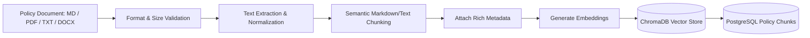
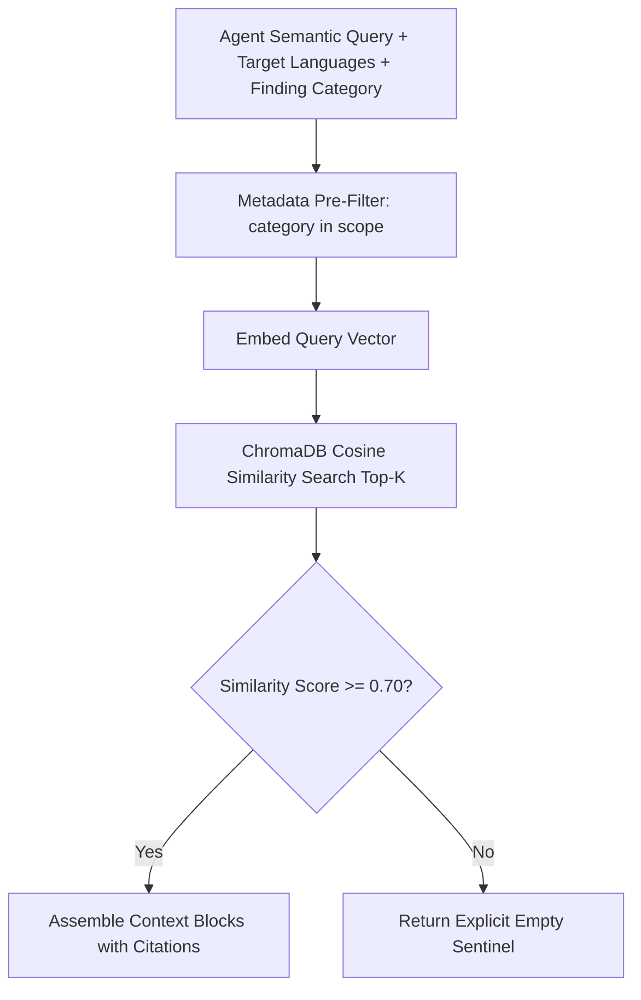

# CodeGuardian AI — Retrieval-Augmented Generation (RAG) Design

**Document:** Engineering Policy RAG Architecture & Anti-Hallucination Protocol  
**Vector Database:** ChromaDB (Persistent Client)  
**Embeddings:** SentenceTransformers (`all-MiniLM-L6-v2`) / Provider Embeddings API  
**Status:** Approved Architectural Baseline  
**Version:** 1.0.0 (Phase 0)  

---

## 1. RAG Ingestion Pipeline



### 1.1. Supported Document Types
- **Markdown (`.md`):** Primary standard for engineering handbooks, security baselines, and style guides.
- **Plain Text (`.txt`):** Simple policy definitions.
- **PDF (`.pdf`):** Formal security compliance specifications and external standards.
- **DOCX (`.docx`):** Corporate architectural requirement documents.

### 1.2. Chunking Strategy
- **Markdown Header Splitting:** Split on `## ` and `### ` headers to preserve structural section boundaries.
- **Size Constraints:** Maximum chunk size = 512 tokens with 64-token overlap to maintain semantic continuity across section cuts.
- **Code Block Integrity:** Code blocks within policies are never split across chunks; they remain encapsulated in the chunk containing their descriptive header.

### 1.3. Metadata Schema
Every chunk indexed into ChromaDB includes:
```json
{
  "document_id": "31f49a0e-...",
  "title": "Database Security & Query Parameterization Baseline",
  "category": "SECURITY_BASELINE",
  "language_scope": ["python", "typescript", "sql"],
  "section": "2.1 Prepared Statements",
  "source_file": "policies/security/db_security.md",
  "version": "1.0.0",
  "created_at": "2026-09-30T17:30:00Z"
}
```

---

## 2. Retrieval Pipeline & Filtering



### 2.1. Hybrid Retrieval Criteria
1. **Pre-Filtering:** Restrict vector search space by `category` (e.g. `SECURITY_BASELINE`) and `language_scope` matching the files in the current PR diff.
2. **Top-K Selection:** Retrieve top $k=3$ most similar chunks per query.
3. **Similarity Score Threshold:** Discard any chunk with a cosine distance greater than $0.30$ (similarity score $< 0.70$) to prevent irrelevant context injection.

---

## 3. Strict Anti-Hallucination Protocol

To prevent LLM agents from fabricating organizational policies or citing non-existent corporate standards, the system enforces the following rules:

1. **Explicit Sentinel on Zero Results:**
   If no policy chunk satisfies the similarity threshold, the RAG service returns:
   ```text
   [POLICY_CONTEXT]: No applicable project policy was retrieved.
   ```
2. **Mandatory Citation Anchoring:**
   Agents are strictly instructed in their system prompt:
   > "You may only reference a policy if it explicitly appears in the provided [POLICY_CONTEXT]. You must cite the exact `policy_name`, `section`, and `source_file`. If [POLICY_CONTEXT] states 'No applicable project policy was retrieved', you must set `policy_reference = null`."
3. **Pydantic Validation Gate:**
   During schema validation, if an agent populates `policy_reference` with a string, the system verifies that the reference matches one of the `document_id` or `title` fields retrieved during that specific review run. Unverified policy references are automatically stripped and flagged.

---

## 4. Evaluation and Quality Assurance

- **Retrieval Precision@3:** Evaluated using a synthetic test suite of 25 engineering questions mapped to ground-truth policy chunks.
- **Zero-Match Precision:** Evaluated against 10 completely unrelated queries (e.g., cooking recipes, sports trivia) to guarantee $100\%$ detection of "No applicable project policy".
- **Audit Logging:** Every RAG query, the query embedding vector hash, retrieved chunk IDs, and similarity scores are logged to PostgreSQL `AgentRun` metadata for forensic verification.
