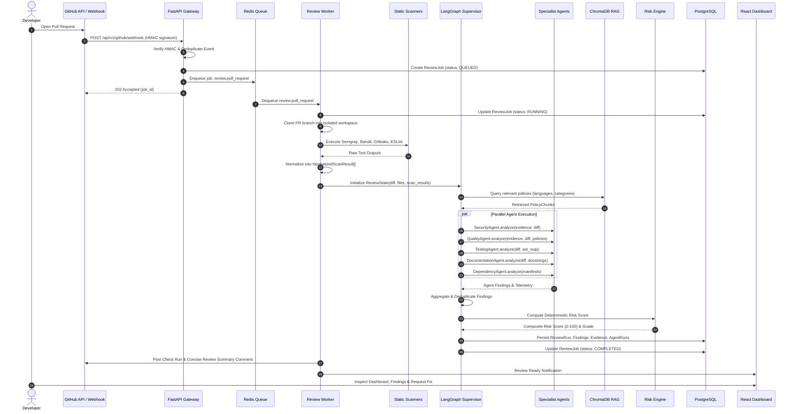
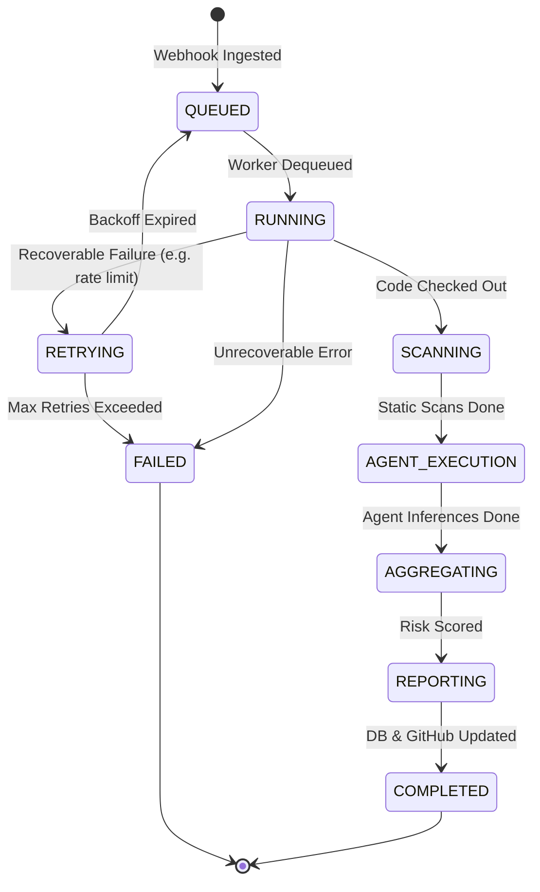
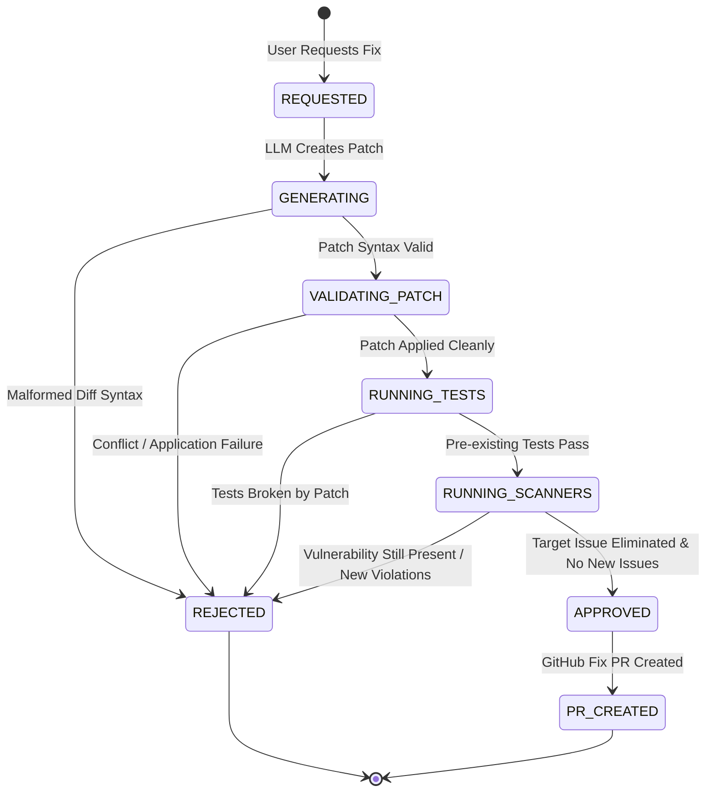

# CodeGuardian AI — System Design Specification

**Document:** System Design, Workflows & State Machines  
**Status:** Approved Architectural Baseline  
**Version:** 1.0.0 (Phase 0)  

---

## 1. System Services and Communication Interfaces

| Service Name | Primary Responsibility | Input Protocol | Output / Storage |
| :--- | :--- | :--- | :--- |
| **API Gateway** | Ingest webhooks, auth, manage CRUD for UI | HTTP REST / JSON | Redis, PostgreSQL |
| **Review Worker** | Dequeue jobs, run orchestrator | Redis Streams / List | PostgreSQL, ChromaDB |
| **Scanner Engine** | Run Semgrep, Bandit, Gitleaks, ESLint | Filepath + diff list | Pydantic `NormalizedScanResult` |
| **LangGraph Supervisor** | Multi-agent coordination and state reduction | `ReviewState` object | Agent task dispatches |
| **RAG Service** | Index policies, semantic vector retrieval | Query text + filters | Top-k `PolicyChunk` |
| **Remediation Engine** | Generate fixes, validate in sandbox | `Finding` + code context | Unified Diff, Fix PR |
| **Web Dashboard** | Developer UI, telemetry, review explorer | HTTP REST / TanStack Query | DOM / User Interface |

---

## 2. End-to-End Review Workflow

---

## 3. State Machines

### 3.1. Review Job State Machine

### 3.2. Remediation Attempt State Machine

---

## 4. Failure Handling and Resilience Strategies

1. **Webhook Ingestion Idempotency:**
   - Every GitHub delivery has an `X-GitHub-Delivery` UUID.
   - Redis sets an idempotency key `idempotency:github:{delivery_id}` with a 24-hour TTL to prevent double-processing on network retries.

2. **Scanner Subprocess Timeouts:**
   - Each scanner process (Semgrep, Bandit, etc.) is bounded by an asynchronous timeout (default: 45 seconds).
   - If a scanner times out or crashes, an error evidence entry is recorded, and the review proceeds with remaining scanner results.

3. **Agent Resilience (Partial Review Degradation):**
   - In LangGraph, specialist agents are executed within `try/except` guardrails.
   - If an agent (e.g., Quality Agent) fails due to LLM provider timeout, the error is recorded in `AgentRun` with status `FAILED`, and the Supervisor aggregates findings from all healthy agents.

4. **Queue Poisoning & Dead-Letter Queue (DLQ):**
   - Jobs that exceed maximum retry attempts (default: 3) are automatically routed to `dlq:reviews` with full stack traces for engineer inspection.
