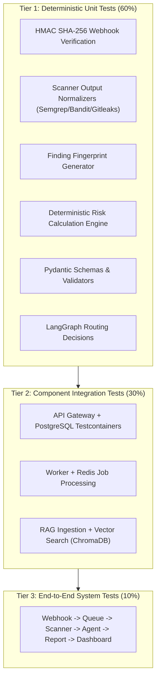

# CodeGuardian AI — Testing Strategy & Evaluation Framework

**Document:** Quality Assurance, Test Architecture & Academic Evaluation  
**Status:** Approved Architectural Baseline  
**Version:** 1.0.0 (Phase 0)  

---

## 1. Multi-Tier Testing Pyramid

---

## 2. Test Suites and Scopes

### 2.1. Unit Testing (`apps/backend/tests/unit/`)
- **`test_webhook_security.py`:** Tests valid HMAC-SHA256 signatures, invalid signatures, missing headers, replay protection, and malformed JSON payloads.
- **`test_scanner_normalization.py`:** Tests parser adapters for Semgrep, Bandit, Gitleaks, and ESLint with mock CLI outputs to verify schema adherence (`NormalizedScanResult`).
- **`test_fingerprinting.py`:** Tests deterministic hashing across varying line offsets, whitespaces, and rule IDs to confirm reproducible grouping.
- **`test_risk_engine.py`:** Validates risk formula outputs across boundary conditions (0 criticals up to multiple critical vulnerabilities) and verifies mathematical invariance.
- **`test_rag_pipeline.py`:** Tests markdown chunking, metadata attachment, threshold filtering, and "no policy found" fallback guarantees.
- **`test_agent_schemas.py`:** Tests strict Pydantic parsing of agent JSON responses and error recovery on malformed LLM outputs.

### 2.2. Integration Testing (`apps/backend/tests/integration/`)
- Uses `pytest-asyncio` with transactional database rollbacks.
- **API + Database Tests:** Exercises full CRUD workflows for repositories, pull requests, findings, and policies.
- **Worker + Queue Tests:** Tests enqueuing via Redis and dequeuing by worker, asserting atomic state transitions in `review_jobs` and `review_runs`.

### 2.3. End-to-End (E2E) Testing (`apps/backend/tests/e2e/`)
- Mocks external GitHub API and LLM Provider endpoints via `pytest-mock` / `respx`.
- Simulates an incoming `pull_request.opened` event.
- Follows the event through Redis, worker checkout, scanner execution, multi-agent evaluation, finding correlation, risk scoring, report synthesis, and database persistence.

---

## 3. Benchmark Dataset (`datasets/benchmark-repository/`)

To support rigorous, defensible evaluation for the B.Tech project, the repository includes a standardized synthetic benchmark test suite containing known, labeled flaws:

| Flaw Category | Test File | Intended Ground Truth Vulnerability |
| :--- | :--- | :--- |
| **Security (SQLi)** | `backend/views/auth.py` | String-formatted raw SQL query (CWE-89) |
| **Security (Command Injection)** | `backend/utils/system.py` | Untrusted subprocess call with `shell=True` (CWE-78) |
| **Security (Hardcoded Secret)** | `config/jwt.py` | High-entropy hardcoded JWT secret key (CWE-798) |
| **Security (Weak Crypto)** | `backend/crypto/hash.py` | Deprecated MD5 password hashing (CWE-327) |
| **Security (XSS)** | `frontend/components/UserBio.tsx` | Unescaped `dangerouslySetInnerHTML` (CWE-79) |
| **Quality (Complexity)** | `backend/services/billing.py` | Single function with cyclomatic complexity $> 25$ |
| **Quality (Duplication)** | `backend/services/orders.py` | 40 lines of identical logic duplicated in 3 functions |
| **Testing Gap** | `backend/services/refunds.py` | Critical business logic module with zero unit test coverage |
| **Documentation Gap** | `backend/api/public_v1.py` | Exported public API endpoints missing docstrings and parameters |
| **Dependency Risk** | `requirements.txt` | Unpinned package dependency and vulnerable library version |

---

## 4. Academic Evaluation Metrics

No numbers will ever be fabricated. When empirical evaluation runs against the benchmark dataset, the following formulas are computed and recorded in `docs/EVALUATION.md`:

1. **Precision ($P$):**
   $$P = \frac{TP}{TP + FP}$$
2. **Recall ($R$):**
   $$R = \frac{TP}{TP + FN}$$
3. **F1-Score ($F_1$):**
   $$F_1 = 2 \cdot \frac{P \cdot R}{P + R}$$
4. **False Positive Rate ($FPR$):**
   $$FPR = \frac{FP}{FP + TN}$$
5. **Review Latency:**
   - Mean, Median, and 95th percentile ($P_{95}$) end-to-end review duration in seconds.
6. **Remediation Validation Pass Rate:**
   $$\text{Fix Pass Rate} = \frac{\text{Validated Clean Fixes}}{\text{Total Fix Attempts}} \times 100\%$$
